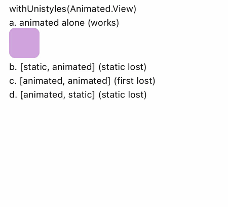

# withUnistyles(Animated.View) drops styles merged with an animated style

Versions: react-native-unistyles 3.5.2, react-native-nitro-modules 0.37.1, react-native-reanimated 4.7.1, react-native-worklets 0.13.0, expo 57.0.12, react-native 0.86.2. Seen on the iOS 26.5 simulator and an Android 11 (API 30) emulator; first found on unistyles 3.3.0 with reanimated 4.5.1.

```bash
pnpm install
pnpm ios      # or: pnpm android
```



react-native-unistyles 3.5.2 on the iOS 26.5 simulator.

`src/App.tsx` renders four `withUnistyles(Animated.View)` boxes:

| Case | `style` | Expected | Actual |
|---|---|---|---|
| a | `animated` | purple pulsing box | purple pulsing box |
| b | `[static, animated]` | blue moving box | nothing: static style dropped, transform still applied |
| c | `[animated, animated]` | purple moving box | nothing: first animated style dropped |
| d | `[animated, static]` | blue moving box | nothing: static style dropped |

The same arrays on a plain `Animated.View`, or on `Animated.createAnimatedComponent(withUnistyles(View))`, render correctly.

Cause: `getSecrets` in `src/core/withUnistyles/withUnistyles.native.tsx` merges the style array into one object with `Object.assign`. The merged object picks up the animated style's `viewDescriptors`, so Reanimated treats the whole object as an animated style and ignores the other keys; a second animated style overwrites the first one's keys.
